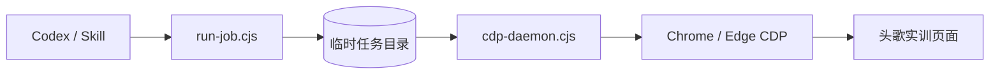

# EducoderSkill

一个给 Codex 使用的头歌（EduCoder）实训助手。

它会接管你已经登录的 Chrome / Edge，读取实训关卡页面，把代码写进 Monaco 编辑器，调用「自测运行」或「评测」，再把结果整理给你。整个流程通过 CDP 连接现有浏览器，不保存账号密码，也不另外启动一个干净的浏览器。

> 非官方项目，与 EduCoder / 头歌平台没有隶属关系。

## 它能做什么

- 自动发现本机浏览器的 CDP 调试端口，复用已登录的会话。
- 读取关卡列表、任务描述、测试说明和预期输出。
- 处理 Monaco 编辑器，避免自动补全引号、括号导致的代码污染。
- 支持「自测运行」和「评测」两种流程，并轮询等待结果。
- 通过常驻 daemon 保持连接，避免每一步都重新连接浏览器。
- 把每次任务的结果以可读文本返回，方便 Codex 继续判断和修正。

## 工作方式



`run-job.cjs` 把一个 JavaScript 片段放进任务队列，`cdp-daemon.cjs` 取出它并在已连接的页面里执行。片段可以直接使用 `page`、`browser`、`require`、`process` 和 `console`，最后 `return` 一个可序列化的结果。

## 环境要求

- Node.js 18 或更高版本
- Chrome 或 Edge
- 一个可以正常登录头歌的账号
- `playwright-core`（`npm install` 会自动安装，不需要下载额外浏览器）

## 快速开始

### 1. 获取代码并安装依赖

```bash
git clone <你的仓库地址> educoder-skill
cd educoder-skill
npm install
```

如果只是本地使用，也可以直接把当前目录作为仓库根目录。

### 2. 启动一个可调试的浏览器

推荐使用独立的浏览器配置目录：第一次登录头歌，之后一直复用这个目录。这样不会影响你平时使用的浏览器，也能避免 Chrome 对默认配置目录的远程调试限制。

先完全退出正在运行的 Chrome / Edge，再执行对应系统的命令。

**Windows（PowerShell）**

```powershell
$profileDir = Join-Path $env:LOCALAPPDATA 'EducoderSkillProfile'
New-Item -ItemType Directory -Force $profileDir | Out-Null

& "$env:ProgramFiles\Google\Chrome\Application\chrome.exe" `
  --remote-debugging-port=9222 `
  --user-data-dir="$profileDir"
```

如果 Chrome 安装在 `Program Files (x86)`，把路径换成：

```powershell
& "${env:ProgramFiles(x86)}\Google\Chrome\Application\chrome.exe" `
  --remote-debugging-port=9222 `
  --user-data-dir="$profileDir"
```

使用 Edge 时，把可执行文件换成 `msedge.exe` 即可。

然后在新终端里设置同一个配置目录：

```powershell
$env:EDUCODER_USER_DATA_DIR = "$env:LOCALAPPDATA\EducoderSkillProfile"
```

**macOS**

```bash
PROFILE="$HOME/Library/Application Support/EducoderSkillProfile"
mkdir -p "$PROFILE"

"/Applications/Google Chrome.app/Contents/MacOS/Google Chrome" \
  --remote-debugging-port=9222 \
  --user-data-dir="$PROFILE"
```

```bash
export EDUCODER_USER_DATA_DIR="$HOME/Library/Application Support/EducoderSkillProfile"
```

**Linux**

```bash
PROFILE="$HOME/.config/educoder-skill-profile"
mkdir -p "$PROFILE"

google-chrome \
  --remote-debugging-port=9222 \
  --user-data-dir="$PROFILE"
```

```bash
export EDUCODER_USER_DATA_DIR="$HOME/.config/educoder-skill-profile"
```

浏览器打开后，访问 [educoder.net](https://www.educoder.net/) 并完成登录。登录状态会保存在这个独立配置目录里。

### 3. 检查连接

```bash
npm run probe
```

看到下面这类结果就说明 CDP 可用：

```text
tcp port open:     true
ws upgrade:        {"upgrade":101}
```

`GET /json/version` 返回 404 不一定是故障。当前版本的 Chrome / Edge 有时会关闭 HTTP 发现接口，但只要浏览器 websocket 能升级成功，`playwright-core` 仍然可以连接。

### 4. 启动常驻 daemon

在第一个终端中运行：

```bash
npm run daemon
```

daemon 会保持 CDP 连接，并每 400 ms 检查一次任务队列。日志默认写到系统临时目录下的 `educoder-homework/daemon.log`。

### 5. 执行一个任务片段

在第二个终端中运行示例：

```bash
npm run job -- examples/hello.js
```

示例片段：

```js
return {
  url: page.url(),
  title: await page.title(),
};
```

成功时会输出 `OK` 和返回内容；失败时会输出 `ERR` 和错误堆栈。

## 安装为 Codex Skill

Codex 会从 `~/.codex/skills/<skill-name>/SKILL.md` 读取技能。这个仓库根目录本身就包含 `SKILL.md`，所以可以把仓库放到对应位置，或者创建软链接。

**Windows（目录联接）**

```powershell
$repo = (Resolve-Path .).Path
New-Item -ItemType Junction `
  -Path "$env:USERPROFILE\.codex\skills\educoder-homework" `
  -Target $repo
```

**macOS / Linux（软链接）**

```bash
ln -s /path/to/educoder-skill ~/.codex/skills/educoder-homework
```

安装后重启 Codex，然后用类似下面的提示词调用：

```text
用 $educoder-homework 完成并提交这个头歌实训：
https://www.educoder.net/tasks/...
```

也可以把要求说得更具体，例如：

```text
先自测，确认全部通过后再提交；如果预期输出和题目描述冲突，以测试结果里的预期输出为准。
```

## 手动调用

不通过 Codex，也可以直接写任务片段。新建 `my-job.js`：

```js
const result = {
  url: page.url(),
  title: await page.title(),
};

return result;
```

然后执行：

```bash
node scripts/run-job.cjs my-job.js
```

第二个参数可以覆盖超时时间，单位是秒：

```bash
node scripts/run-job.cjs my-job.js 300
```

## 配置项

| 环境变量 | 作用 | 默认值 |
| --- | --- | --- |
| `CDP_ENDPOINT` | 直接指定 CDP websocket 地址，优先级最高 | 自动发现 |
| `EDUCODER_USER_DATA_DIR` | 包含 `DevToolsActivePort` 的浏览器配置目录 | 自动检查 Edge / Chrome 的常见目录 |
| `EDUCODER_RUNTIME_DIR` | 任务队列、日志等运行时文件的位置 | 系统临时目录下的 `educoder-homework` |

## 项目结构

```text
.
├── SKILL.md                 # Codex 技能说明与使用流程
├── agents/
│   └── openai.yaml          # 技能展示信息
├── references/
│   └── educoder.md          # 页面结构、选择器和现成片段
├── scripts/
│   ├── lib.cjs              # CDP 发现与运行时目录
│   ├── cdp-probe.cjs        # 连接诊断
│   ├── cdp-daemon.cjs       # 常驻 CDP 连接与任务执行器
│   └── run-job.cjs          # 提交任务并等待结果
├── examples/
│   ├── hello.js             # 检查当前页面
│   └── list-levels.js       # 列出页面中的实训关卡
├── package.json
├── LICENSE
└── README.md
```

## 排错

| 现象 | 可能原因 | 处理 |
| --- | --- | --- |
| 所有配置目录都显示 `[ missing ]` | 浏览器没有用调试端口启动 | 按上面的命令重新启动浏览器 |
| `tcp port open: false` | 浏览器已关闭，或 `DevToolsActivePort` 是旧文件 | 关闭残留进程，重新启动调试浏览器 |
| `/json/version` 返回 404，但 `ws upgrade` 是 101 | 浏览器关闭了 HTTP 发现接口 | 正常，直接用 websocket 连接即可 |
| `Cannot find module 'playwright-core'` | 依赖没有安装 | 在仓库根目录执行 `npm install` |
| `TIMEOUT waiting for job` | daemon 没启动，或浏览器没有连接成功 | 先运行 `npm run probe`，再启动 `npm run daemon` |
| daemon 一直重试连接 | 浏览器还没准备好，或端口不一致 | 检查调试端口和 `EDUCODER_USER_DATA_DIR` |
| 评测长时间没有结果 | 平台容器启动较慢 | 单个关卡通常需要 20–90 秒，耐心等待 |
| 编辑器内容没有被替换 | 页面还没渲染完，或焦点不在编辑器 | 等 Monaco 出现后再操作，并使用 `insertText` |

更完整的页面结构和选择器说明见 [references/educoder.md](references/educoder.md)。

## 已知边界

- 目前主要按头歌的 Monaco 编辑器和 MySQL 实训页面验证，其他课程类型可能需要调整选择器。
- 页面 DOM、按钮文案或评测流程变化后，脚本可能需要同步更新。
- 不适合拿来做通用浏览器自动化；它只处理头歌实训的场景。
- 不包含绕过登录、验证码或课程权限的能力。

## 开发与贡献

检查 JavaScript 语法：

```bash
npm run check
```

提交前请确认：

- 不提交真实答案、课程 ID、Cookie、账号信息或带个人信息的截图。
- 新的页面选择器尽量写在 `references/educoder.md`，保持主流程简单。
- 修改脚本后至少跑一次 `npm run probe` 和 `npm run check`。
- 涉及真实平台的改动，请在自己的账号和获准的课程里验证。

## 使用边界

这个工具会复用你本机浏览器的登录态，并把「评测」结果提交到头歌平台。请只在你有权限使用的账号和课程里使用，并遵守所在学校、课程和平台的要求。首次提交前建议先用「自测运行」确认结果。

运行时文件默认放在系统临时目录，不包含账号密码。请不要把 `daemon.log`、任务输出或浏览器配置目录提交到仓库。

## License

[MIT](LICENSE)
